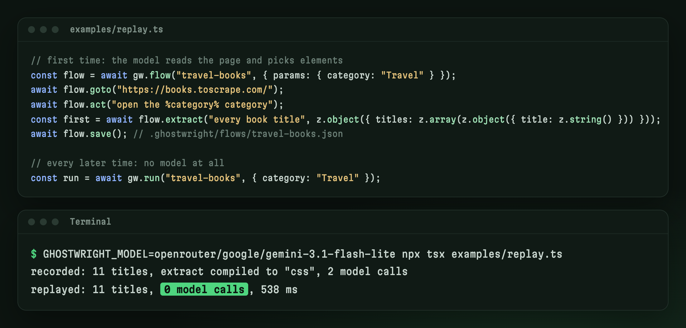
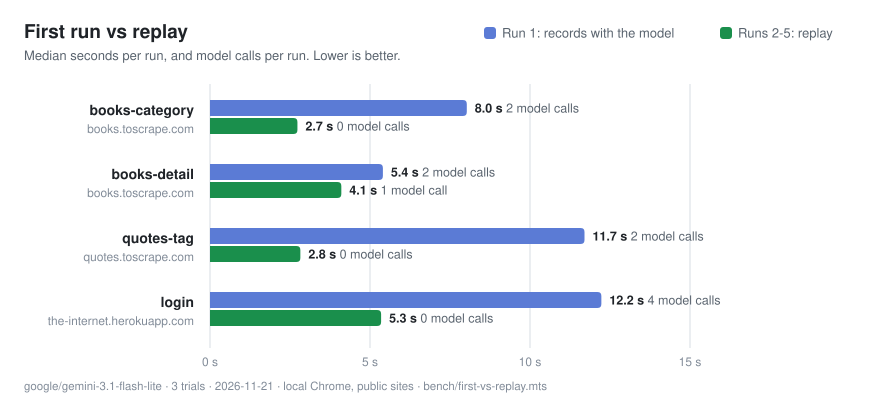

<p align="center">
  <a href="https://browsa.io/ghostwright">
    <picture>
      <source media="(prefers-color-scheme: dark)" srcset="https://raw.githubusercontent.com/browsa-io/ghostwright/main/assets/logo-dark.svg">
      
    </picture>
  </a>
</p>

<p align="center"><b>Browser agents that replay without a model.</b></p>

<p align="center">
  <a href="https://www.npmjs.com/package/ghostwright"></a>
  <a href="https://github.com/browsa-io/ghostwright/blob/main/LICENSE"></a>
  <a href="https://github.com/browsa-io/ghostwright/actions/workflows/ci.yml"></a>
  
  <a href="https://browsa.io"></a>
</p>

<p align="center">
  <a href="https://browsa.io/ghostwright">Docs</a> ·
  <a href="#quickstart">Quickstart</a> ·
  <a href="https://github.com/browsa-io/ghostwright">⭐ Star this repo</a>
</p>

<p align="center">
  
</p>

## Why

- **Replay with 0 model calls.** Describe each step in plain words once; Ghostwright saves what worked as a recipe, and later runs replay it without a model. When a site changes, the broken step is repaired with one model call and kept only after the whole flow passes, or held as a draft for your review.
- **Secrets by reference, locked to their sites.** The model sees `%password%`, never the value. The value is typed only into a field on an origin you allowed, and never reaches a prompt, a trace or a saved flow.
- **Runs where your browser is.** Your local Chrome, any CDP endpoint, or Browsa's cloud browsers. Any model: OpenAI, Anthropic, Google, OpenRouter, DeepSeek, or an OpenAI-compatible endpoint. MIT licensed.

## Quickstart

```sh
npm install ghostwright zod
```

```ts
import { Ghostwright } from "ghostwright";
import { z } from "zod";

const gw = await Ghostwright.create({ model: "openai/gpt-5.6-luna" });  // reads OPENAI_API_KEY
const flow = await gw.flow("travel-books", { params: { category: "Travel" } });
await flow.goto("https://books.toscrape.com/");
await flow.act("open the %category% category");                        // the model picks the link
await flow.extract("every book title", z.object({ titles: z.array(z.object({ title: z.string() })) }));
await flow.save();                                                      // .ghostwright/flows/travel-books.json
const run = await gw.run("travel-books", { category: "Poetry" });       // replay: run.meta.modelCalls is 0
await gw.close();
```

Ghostwright is an ES module and the snippets use top-level `await`, so your project must be one too. In a new project (`npm init -y`), run `npm pkg set type=module` once; then save the snippet as `index.js` and run `node index.js`, or as `index.ts` and run `npx tsx index.ts`. Without that setting, name the file `index.mjs` (`node index.mjs`) or `index.mts` (`npx tsx index.mts`).

It drives the Chrome installed on your machine (`local()`); no browser download. From a terminal: `GHOSTWRIGHT_MODEL=openai/gpt-5.6-luna npx ghostwright extract https://books.toscrape.com "every book title"` prints JSON and what it cost.

## First run vs replay

<picture>
  <source media="(prefers-color-scheme: dark)" srcset="https://raw.githubusercontent.com/browsa-io/ghostwright/main/assets/speed-dark.svg">
  
</picture>

| Flow | Run 1 (records) | Runs 2-5 (replay), median and range | Model calls per run: run 1 / replay | Model cost per run: run 1 / replay | Passed: run 1, replays |
|---|---|---|---|---|---|
| `books-category` books.toscrape.com: open a category, read every book with its price | 11.4 s | 2.5 s (0.5 s to 14.3 s) | 2 / 0 | $0.0016 / $0 | 3/3, 12/12 |
| `books-detail` books.toscrape.com: open a book from the front page, read its price and whether it is in stock | 4.4 s | 3.5 s (1.6 s to 5.7 s) | 2 / 1 | $0.00079 / $0.00029 | 3/3, 12/12 |
| `quotes-tag` quotes.toscrape.com: open a tag, read every quote with its author | 8.3 s | 2.3 s (1.9 s to 2.3 s) | 2 / 0 | $0.0022 / $0 | 3/3, 12/12 |
| `login` the-internet.herokuapp.com: sign in with the site's public demo account, read the message | 11.5 s | 7.0 s (6.0 s to 7.6 s) | 4 / 1 | $0.00083 / $0.00014 | 3/3, 12/12 |

**How this was measured** (2026-11-19, [`bench/first-vs-replay.mts`](bench/first-vs-replay.mts), raw runs in [`bench/results/`](bench/results/)):

- Run 1 records the flow with `google/gemini-3.1-flash-lite` through OpenRouter. Runs 2-5 call `run()` on it with the same inputs and default options (a broken step would be repaired with the model, and counted). Each of 3 trials records every flow again under a new name. Medians are over 3 recordings and 12 replays.
- Wall clock from the first call to the result, in one headless local Chrome that was already open, on an Apple M2 laptop, over the internet to the public sites. Site load time is included, and it varies: one trial's books.toscrape.com replays took 6 to 14 s against 0.5 s in another. Most of the login replay is the site itself: loading the form and signing in take about 2 to 3 s each.
- Model cost is what `usage()` reports: the provider's token counts at the SDK's price table. The whole benchmark (60 runs, 60 passed) made 54 model calls for $0.022.
- Two flows keep one model call per replay: their extract did not compile to a page read, so it asks the model each run, and `flow.save()` warns about it. `books-detail` reads "in stock" as a yes or no, which takes judgment, and the login message did not compile either.
- The code measured is this repository's on that date, which includes a replay fix made after 0.1.0 (two links on a page with the same name).

Reproduce it: `OPENROUTER_API_KEY=... npx tsx bench/first-vs-replay.mts`, then `npx tsx bench/render-chart.mts` to redraw the chart. `--new-params` replays with other inputs (another category, book or tag) instead of the same ones.

## How it works

Describe a step in plain words once. Ghostwright asks a model, does it with real input, checks that it worked, and saves it as a recipe. Every later run replays the recipe with **0 model calls**. When the site changes, the one broken step is repaired with one model call, and the fix is kept only after the whole flow passes.

- Works on your local Chrome, any CDP endpoint, or Phantom, Browsa's own browser. No browser extension.
- Any model: OpenAI, Anthropic, Google, OpenRouter, DeepSeek, any OpenAI-compatible endpoint, or your own function.
- Small views: a page is a compact list of what a person can see, inside a token budget (about 1,500 tokens for a long Wikipedia article).
- Secrets: the model sees `%password%`, never the value.
- Safe by default: no orders, payments or subscriptions unless you allow them.
- MIT licensed.

### Without a flow

`act`, `extract` and the rest work on their own too; only a flow is saved and replayed.

```ts
const gw = await Ghostwright.create({ model: "openai/gpt-5.6-luna" });
await gw.goto("https://books.toscrape.com");
await gw.act("open the Travel category");
const { data } = await gw.extract("every book with its price", z.object({ books: z.array(z.object({ title: z.string(), price: z.number() })) }));
console.log(data.books, gw.usage());
await gw.close();
```

## Record once, replay with no model

```ts
const flow = await gw.flow("travel-books", { params: { category: "Travel" } });
await flow.goto("https://books.toscrape.com/");
await flow.act("open the %category% category");
await flow.extract("every book title", z.object({ titles: z.array(z.object({ title: z.string() })) }));
await flow.save();                                   // .ghostwright/flows/travel-books.json

const run = await gw.run("travel-books", { category: "Poetry" });
run.output;               // the titles
run.meta.modelCalls;      // 0
```

What a replay does for each step:

1. **Finds the element** with the step's locator list, tried together: role and name, CSS (it crosses open shadow roots), visible text, XPath, the nearest heading, the frame. One absolute XPath is not enough when a site moves things around. A locator that holds a param (`{{category}}`) must match with this run's value: the recorded position is never used for it, so `{ category: "Nonexistent" }` fails instead of clicking the first item. A field for a secret must match by its label or selector, never by position alone.
2. **Acts with trusted input** (real mouse and key events), after checking that nothing covers the element.
3. **Checks the effect.** A click that changed nothing, a field that did not take the text, or a page that did not navigate like it did when recorded is a failure, not a success. A step that navigated must land on the path it went to when recorded (digits, and the parts that held a param, may differ; on a page the params shaped, one more part may).
4. **Repairs** a failed step with one model call on the current page. The repaired recipe becomes a new version only when the whole run passes (output valid, assertions true). `gw.rollback(name)` goes back. A step a safety guard refused (purchase, origin, secret rules) is never repaired: the run fails with `FlowError` `blocked`.

A repair stays a draft for you to review (`run().draft`, then `gw.promote(name)`) when it goes to a host the flow never used. A repair that would type a secret into a field the step did not type it into types nothing: the run fails with `FlowError` `needs_review` and the repaired step waits as a draft until `gw.promote(name)`. Flows that type secrets keep every repair for review unless saved with `flow.save({ repair: "auto" })`. A repair may type only the secrets the broken step typed.

A flow with no model configured never calls one: a broken step fails with `FlowError` (`site_changed`).

### Extracts that compile

After a model extract in a flow, Ghostwright tries to build an extractor that needs no model, in this order:

1. the JSON the page fetched while you worked (replayed as an in-page `fetch` with your cookies; `GET` only),
2. JSON embedded in the page (`__NEXT_DATA__`, `application/ld+json`),
3. CSS selectors (text, or the `title`, `alt` or `aria-label` attribute when that holds the full value).

It keeps one only when the data it reads matches the model's answer: same items, in the same order, every field equal. Only these differences are allowed, all of them in text fields:

- **Typography**: curly quotes and straight quotes are the same, so are dashes and hyphens, `…` and `...`, and runs of spaces or line breaks. Text is compared after Unicode NFKC normalisation.
- **Text cut short**: the view shows at most 80 characters of a name and ends a longer one with `…`, and sites cut titles with `...`. A model can only copy what it saw, so its value ending in `…` or `...` (at least 10 characters before it) matches the page's full text when that text starts with it.

Numbers must be equal, booleans and nulls too, and nothing else is loose. When an extractor is kept, `extract()` returns what it read (the page's own, complete text), and replays read the same way. `meta.layer` says which one was kept: `fetch`, `page_json`, `css`, or `model` when none matched; `flow.save()` warns (a `warning` event, and `console.warn` unless `warnings: false`) about each extract that stays `model`, since it calls the model on every run.

Outside a flow, `extract()` also returns full text: a value the model copied cut short is completed from the page when exactly one text there starts with it.

## The API

```ts
Ghostwright.create(options)                            // see Options below

gw.goto(url)
gw.act("click the sign in button", { variables })      // { ok, action, result, reason, meta }
gw.observe()                                           // the page view, no model
gw.observe("the search box")                           // candidates with locators (one model call)
gw.extract("what to read", zodSchema | jsonSchema)     // { data, meta }; a JSON Schema is checked before any model call
gw.extract("what to read", schema, { html })           // from HTML of your own (or { file }): a separate context, scripts off, offline
gw.check("the cart shows 2 items")                     // { ok, evidence } from one model call
gw.agent("task", { maxSteps, mode: "dom" | "hybrid" }) // { status, success, answer, evidence, history, meta }
gw.do({ action: "click", role: "button", name: "Save" })  // an exact action, no model; text "%password%" types that secret

gw.waitForReady({ timeoutMs })   // requests and layout quiet, content shown
gw.tabs()                        // open tabs with their real titles
gw.last()                        // the last model call: prompt (view included), answer, plan, tokens, $; secrets masked

gw.flow(name, { params })  ->  flow.goto / act / extract / observe / agent / save({ repair }) / discard(); flow.steps
gw.run(name, params, { repair, maxRepairs })   // replay: { output, version, repaired, promoted?, draft?, steps, meta }
gw.promote(name)           // use the draft a repair left for review
gw.rollback(name, version?)
gw.usage(), gw.metrics()   // tokens, $, ms; per kind of call and per call
gw.page                    // the page, for your own code
gw.close()

gw.push(name), gw.runOnBrowsa(name, params), gw.robot(name, o), gw.unpush(name)   // Browsa cloud, see below
```

Actions (`do()` and what the model picks): `click` (also double, right, at x,y), `type` (clear, submit), `press` (`Control+A`, `Tab Tab Enter`), `select`, `check`, `uncheck`, `hover`, `scroll`, `navigate`, `back`, `forward`, `reload`, `wait`, `upload`, `dialog`. The model can also `expand` a list or table the view folded (`… 30 more items (expand [8])`) to act on an item in it.

`act()` result: `ok` is true only when the action did what was asked. A target below the fold is acted on, not just scrolled to (an `act` that only scrolled is `ok: false`, unless the instruction asks to scroll). When a safety guard refuses the action (a purchase, an origin, a secret rule, a popup to a refused origin), `ok` is false with the guard's `reason`, and the model is not asked for another way.

### Options

| option | default | |
|---|---|---|
| `browser` | `local()` | `local()`, `cdp(url)` or `browsa({ apiKey })` |
| `model` | none | a model, or a list (fallbacks in order) |
| `fallbackModels` | `[]` | models tried after the model fails |
| `modelApiKey` | the provider's env variable | the first model's key |
| `modelTimeoutMs` | `60000` | the longest one model call may take |
| `price` | table, live catalog | US$ per million tokens for the first model |
| `livePrices`, `cacheDir` | `true`, `~/.cache/ghostwright` | the live price lookup and its cache |
| `maxCostUsd` | none | stop before model spend passes this |
| `secrets` | `{}` | named secrets, see Secrets |
| `store` | `".ghostwright"` | the folder for flows, drafts and traces |
| `allowPurchases` | `false` | allow order, pay and subscribe actions |
| `allowedOrigins` | any | origins pages may load from |
| `allowFileUrls` | `false` | let pages open `file:` addresses |
| `selfHeal` | `true` | one more model call when an action fails (never after a guard refused it) |
| `viewBudget` | `2000` | view size in approximate tokens |
| `settle` | | how long to wait for a page to go quiet |
| `captcha`, `maxCaptchaSolves` | none, `5` | the local token captcha solver and its cap |
| `debug` | `false` | print each step, or a function that gets each line |
| `onEvent` | | `model-call`, `captcha`, `repair`, `promote`, `warning` events |
| `warnings` | `true` | print warnings (an extract that did not compile) with `console.warn` |
| `browsaApiKey`, `browsaBaseUrl` | `BROWSA_API_KEY` | Browsa cloud calls |

### Errors

Wrong options (a schema that is not a JSON Schema too) throw a `TypeError` at once, before any model call. Everything else is a `GhostwrightError` with a `code`: `no_model`, `cost_limit`, `secret_origin`, `secret_not_named`, `secret_unset` (an env variable not set), `secret_in_recipe`, `challenge`, `action_failed`, `browser_unreachable` (`cdp()`), `browser_missing` and `browser_sandbox` (`local()`, with what to pass); `FlowError` (`site_changed`, `blocked`, `needs_review`, `secret_missing`: the flow types a secret this Ghostwright does not have, `no_model`: an extract that did not compile needs a model, `invalid_output`, `params_invalid`, `not_found`); `ModelError` from the provider (`model_auth`: the key is missing or wrong, the message names the env variable; `model_rate_limit`: 429; `model_not_found`; `model_unavailable`: 5xx; `model_error`).

Dropdowns: a native `<select>` is chosen with the keyboard; for a custom one, when a click opens a menu or list, Ghostwright asks once more on what opened and picks the option.

### check()

`gw.check(statement)` asks the model whether a statement about the page is true and which words on the page show it. `ok` is true only when the model says so **and** those words are on the page; `evidence` has the words, whether they were found, the URL and the element.

### agent()

`agent()` in `dom` mode works over the view; `hybrid` also sends a screenshot and accepts clicks by position. Inside a flow, every step of an agent run is recorded, so one agent run gives you a flow that replays.

- **Verdict**: `success` is `true`, `false` or `"unknown"`. A missing verdict, an empty answer ("done", "N/A", the task read back), or a claim of success without words found on the page is `"unknown"`, never success. `evidence` has the final URL, the last action's effect, and the words the model cited with `found`.
- **What the model reads back**: after each action, what it did: navigated (where), changed, no change, or for typing what the field now holds (secrets masked).
- **Stall guard**: the same action on the same page twice, or three actions in a row that change nothing, adds a note to the model; at four repeats or six idle actions the run ends with `status: "stalled"`. Tune with `stall: { repeatNote, repeatStop, idleNote, idleStop }`.
- **Budget**: the model is never told how many steps it has. On the last allowed step it must answer with what it found; otherwise the run ends `max_steps`.

## Safety

- **Purchases**: clicks and submits that place an order, pay, subscribe, donate, book or start a paid trial are refused below the model (whoever chose the action: a model, `do()`, or a replayed flow), with labels in English (including the EU "Order with obligation to pay"), German, French, Spanish, Italian, Portuguese, Dutch, Polish, Swedish, Turkish, Russian, Chinese, Japanese and Korean. Covered: a click by id or by point (also inside a frame), Enter, NumpadEnter or Space anywhere in a key sequence (on the focused element, through shadow roots and frames), a newline in typed text, a submit of a form whose submit control buys (`form.elements`, so `form="..."` buttons count), any submit of a form with card fields (cc-number, cvc, expiry), and an unlabelled submit of an order or payment form. A buying label wins over a harmless one on the same control; "Add to cart" and "Proceed to checkout" pass. `allowPurchases: true` lifts it.
- **Addresses**: only `http:`, `https:` and `about:blank` are opened, before and after every action: `file:`, `chrome:`, `devtools:`, `view-source:`, `data:`, `javascript:`, `blob:` and `filesystem:` are refused, and a page that ends up on one is left. `allowFileUrls: true` allows `file:`.
- **Origins**: `allowedOrigins: ["shop.example.com", "*.example.com"]` stops page loads elsewhere before the request is sent, for every frame and popup; `goto()` and `navigate` are refused, a popup that ends up elsewhere (or stays blank) is closed and the action that opened it returns `ok: false` with the reason, and a click that tried to leave fails. Subresources (images, scripts, API calls) are not filtered.
- **Local Chrome** runs with its sandbox on; `local({ sandbox: false })` turns it off where a container cannot run it.
- Ghostwright reads the page from an isolated world and never writes attributes, styles or scripts into it. The one exception is the local token captcha solver (`captcha: browsaCaptcha()`), which puts the solved token into the widget's response field, as the widget itself would.

## Browsers

```ts
import { local, cdp, browsa } from "ghostwright";

local({ headless: false, userDataDir: "./profile" })   // the Chrome on this machine
cdp(wsUrl)                                              // a browser you started, by its exact ws:// address: drives its first open tab
browsa({ apiKey, proxy: { network: "auto" } })          // Phantom, Browsa's own browser (npm i browsa)
```

`cdp()` takes over the browser's current tab: the first open tab of its default context (a new tab only when there is none), with whatever that tab has open and its cookies. Attach only to a browser you started yourself, for this: launch it with `--remote-debugging-port=0` (a free port), read the exact `ws://` address it prints, and pass that. A fixed port such as 9222 may be another program's browser. `close()` disconnects and leaves that browser running.

Frames from other sites and closed shadow roots are part of the view: elements inside them get ids like any other and take clicks and typing.

## Models

```ts
model: "openai/gpt-5.6-luna"                  // OPENAI_API_KEY
model: "anthropic/claude-sonnet-5.5"          // ANTHROPIC_API_KEY
model: "google/gemini-3.1-flash-lite"         // GOOGLE_GENERATIVE_AI_API_KEY or GEMINI_API_KEY
model: "openrouter/deepseek/deepseek-v4.1-flash"  // OPENROUTER_API_KEY
model: "deepseek/deepseek-chat"               // DEEPSEEK_API_KEY
model: { provider: "openai-compatible", baseURL: "http://localhost:11434/v1", model: "qwen3" }
model: { generate: async ({ system, prompt, images, signal }) => callMyModel(system, prompt) }
model: ["google/gemini-3.1-flash-lite", "openai/gpt-5.6-luna"]   // a list: fallbacks in order
```

- There is no default model. Without one, `run()` replays and everything else that needs a model throws `NoModelError`.
- Each call has `modelTimeoutMs` (default 60 s) and one retry on a transient error (a timeout, a rate limit, a 5xx, a dropped connection); then the next model of the list (or `fallbackModels`) is asked.
- Calls run at temperature 0 and never send a frequency or presence penalty: ids and names must be copied exactly.

## Secrets

```ts
import { env, secret, browsaSecret } from "ghostwright";

secrets: {
  email: env("APP_EMAIL", { origins: ["app.example.com"] }),
  password: secret(async () => readFromMyVault("app"), { origins: ["app.example.com"] }),   // read at create and at each keystroke
  code: browsaSecret("APP_TOTP", { totp: true, local: env("APP_TOTP_SEED", { origins: ["app.example.com"] }) }),
}
await gw.act("type %password% into the password field");
```

- The model sees `%password%`, and only the secrets the instruction names: `act()` may type the secrets written as `%name%` in its instruction, `agent()` the ones in its task or listed in `agent(task, { secrets: [...] })`. Any other is refused (`SecretNotAllowedError`).
- The value is read once when Ghostwright starts (so it is masked from the first prompt, even on a page that shows it before anything is typed) and again when it is typed (a function is called each time, so any vault CLI or one-time code source plugs in), for the document the field is in, and only when that document's origin is allowed (the frame's own origin counts; the origin is checked before the value is read). It is then put into the field itself by one call on that element, which checks again, in the page, that the element is still there and its document still has that origin. No key goes to whatever has focus, so a page that moves focus, opens a frame over the field or redirects on focus gets nothing. If the page rejects the value, keys are sent one at a time, each after checking focus, element, origin and document.
- Refused: a field on another origin (`SecretOriginError`), a field whose `maxlength` is shorter than the value, a search box, a field in a form that says it sends its fields in the address (`method="get"`, or a submit button with `formmethod="get"`), and an editable region that is not a text field. A `<form>` with no `method` is allowed: single-page apps post those from a script.
- Once a secret was typed, a page load whose address carries its whole value (any encoding or case) is stopped before the request is sent, whatever sent it: a form with no method submitted natively (the browser sends it as GET), a script, a link.
- A field holding a secret is shown as `value hidden`, with no value and no length (a password field too). In `hybrid` mode no screenshot is sent while such a field, or any text showing a secret's value, is in view.
- Values are scrubbed from every prompt, result, trace and `last()`: the whole value as typed, JSON-escaped, URL- and form-encoded, in any letter case, and any run of 12 or more of its characters as written (a value cut short or shown in part). Placeholders and recipe tokens are never touched, so a label like "Password" stays when the password is "SuperSecretPassword!". A saved recipe is never rewritten: a locator that holds a value is dropped from its step (the others stay), and any other text holding one stops the save (`secret_in_recipe`).
- A recipe stores Browsa Secrets tokens: `{{secret:APP_EMAIL}}`, `{{secret:NAME:password}}`, `{{totp:NAME}}`. The name is the `browsaSecret()` name, an UPPER_CASE `env()` variable name, or the local name upper-cased. So the same file runs here (the token maps back to your local secret) and on Browsa (Browsa Secrets types it).
- `browsaSecret("NAME")` is a secret kept in Browsa Secrets. Its value never leaves Browsa: flows that type it run on Browsa; pass `local:` to type it on this machine too. `totp: true` makes a 6-digit RFC 6238 code from the seed at the keystroke.
- Plain values go in `params` or `variables`: the model sees them, and the recipe stores `{{name}}` so the next run can use another value.

## Cost, usage, traces

- Every call returns `meta: { modelCalls, inputTokens, outputTokens, usd, ms }`; `gw.usage()` adds them up and `gw.metrics()` lists every model call.
- **Prices**: a built-in table of the current models (`PRICES`, a snapshot of OpenRouter's public catalog of providers' prices taken on `PRICES_AS_OF`, 2026-11-19). A model missing from it is looked up in that live catalog (no key is sent; cached a day in `~/.cache/ghostwright/prices.json`, outside the store you commit; `cacheDir` or `GHOSTWRIGHT_CACHE_DIR` moves it; a cache dated in the future is ignored; `livePrices: false` turns the lookup off). Only a dated or `-latest` variant borrows a listed model's price (`gpt-5-pro` is not `gpt-5`). `price: { input, output }` (US$ per million tokens) sets it yourself.
- **maxCostUsd** stops before a model call that could pass the cap (`CostLimitError`), counting the prompt plus the whole output limit (2,000 tokens). The error says what that call could cost and at which price. A model the cap refuses passes to the next model of the list, so a cheap fallback still runs. A call that timed out counts at that estimate (it was sent and may be billed), and a provider's token counts are clamped to finite, non-negative numbers. A model whose price is still unknown is counted at `ASSUMED_PRICE` ($10 in, $50 out per million tokens: the most expensive regular model of the snapshot), and those calls say `priceAssumed`; `usage().usdAssumed` is the part counted that way. "Pro" reasoning tiers cost more: pass `price` for those.
- Each flow recording and run writes `.ghostwright/traces/<flow>-<run>.jsonl`, one line per step (secrets scrubbed). Nothing is printed unless `debug: true`, except `flow.save()` warnings (`warnings: false` turns them off).
- `onEvent` receives `model-call` (with `hosted` for a model service that bills per step), `captcha`, `repair`, `promote` and `warning` events.

## Captchas

- On Phantom (`browsa()`), Browsa's in-session solver works on the server; Ghostwright reports a `captcha` event and waits.
- Locally, `captcha: browsaCaptcha({ apiKey })` solves token captchas (reCAPTCHA, Turnstile) through captcha.browsa.io, paid with Browsa credits: each widget once per page, at most 2 per page and `maxCaptchaSolves` (5) per Ghostwright.
- Otherwise a full-page bot check raises `ChallengeError`.

## The store and the recipe format

```
.ghostwright/
  flows/<name>.json        the version run() uses
  flows/<name>/v<N>.json   every version, for rollback
  drafts/                  repairs waiting for review, or that failed
  traces/                  one JSONL file per run
  browsa.json              which Browsa recipe and robot each flow was pushed to
```

Commit it to git. A flow is saved in Browsa's recipe format (`schema/recipe-v1.json`), so the same file runs here and on Browsa. Files are written for your user only (0600, folders 0700), and a store an older version made is tightened to those modes when Ghostwright starts. A flow's name always comes from the name you run it by, never from the file, so a shared file cannot write elsewhere. Compiled request URLs are saved without query parameters that look like credentials (`token`, `key`, `sig`, `session`, a JWT or a long random value).

CLI: `npx ghostwright list`, `run <flow> key=value`, `rollback <flow>`, `view <url>`, `extract <url|file> "<what>" [--schema file.json]`.

## Run it on Browsa

These calls use Browsa's cloud and are paid with Browsa credits. Everything above is free and runs on your machine.

```ts
const gw = await Ghostwright.create({ browsaApiKey: process.env.BROWSA_API_KEY });

await gw.push("travel-books");                         // { recipeId, priceCredits, secretNames }
const r = await gw.runOnBrowsa("travel-books", { category: "Poetry" });
// on Phantom, captchas solved server-side, repairs on Browsa; r.output, r.credits
await gw.robot("travel-books", { rows: [{ category: "Poetry" }, { category: "Travel" }], schedule: "1d", alerts: [{ field: "titles", op: "changed" }] });
await gw.unpush("travel-books");                       // deletes its robot and recipe on Browsa; the local flow stays
```

- **Deleting**: `gw.unpush(name)` deletes the flow's robot (if `robot()` made one) and its Browsa recipe, and forgets the link in `browsa.json`. A robot or recipe made some other way is deleted with `DELETE /v1/robots/{id}` or `DELETE /v1/recipes/{id}`, or in the dashboard. Past runs stay in your Browsa history (billing).

- **Secrets**: a pushed recipe carries only tokens by name (`{{secret:APP_LOGIN:password}}`); save the values once in Browsa Secrets (`POST /v1/secrets`). `runOnBrowsa()` names them in `secret_ids`; robot runs attach them from the recipe. No value is ever sent: a push that would hold one is refused, and so is a token outside a `type` step.
- **Transport**: API keys go only over https (`baseUrl` and the `BROWSA_*` URLs; plain http only to localhost), and `browsa()` connects only to a browser endpoint on Browsa's own domain.
- **Versions**: pushing a flow that has not changed since its last push uploads nothing and returns the same recipe (`unchanged: true`). Browsa takes a recipe upload as a new recipe, so each push of a changed flow makes a new Browsa recipe (`runOnBrowsa()` pushes when the local flow is newer). The flow's robot is moved to it in place (same robot, same id). The recipe it replaces is deleted when no robot and no schedule uses it any more; otherwise it is kept and `push()` says what still uses it (`replaced.keptFor`). `push(name, { keepOld: true })` keeps it anyway.

## Coming from other browser-agent SDKs

- `act`, `observe` and `extract` with a zod schema work the way you expect; `%name%` placeholders are supported, and secrets are pinned to origins.
- Replays need no cache service: `flow()` and `run()` keep recipes on disk, and they replay with no model on any browser.
- `agent()` is here, in `dom` and `hybrid` modes, and its runs can be saved as flows.
- Attaching to a browser needs no extension: anything with a CDP endpoint works.

## Limits of 0.1

- TypeScript only; the Python client comes next.
- `agent()` has no coordinate-only mode for computer-use models yet.
- `check()` always calls the model; compiling a passing check into a replay assertion comes in 0.2.
- A click on one item of a list, recorded with a param, keeps the closest heading before it as context, and on a page of cards that heading can be the card before. A replay with another item then repairs that step (one model call). The benchmark's `books-detail` flow shows it with `--new-params`.
- Locally, stock Chrome faces bot walls like any automated browser. Attaching goes through Playwright, which a page can notice; Phantom is the browser for protected sites.
- The purchase guard reads labels and forms. A button whose only label is an image with no text, outside any order or card form, is not recognised.
- `allowedOrigins` filters page loads, not subresources: an image or script on an allowed page can still reach another origin.
- Scrubbing catches a part of a value from 12 characters on, as written: a shorter part, or a part in another letter case, is not masked (it is too often an ordinary word). It does not catch a page that shows a secret transformed (spaced out, reversed, re-encoded some other way); such a page already holds the value, on an origin you allowed.
- The purchase guard judges the control that is clicked. A page script that submits an order form from a harmless-looking click (`requestSubmit()` behind "Continue") is not caught; only a check on the network requests themselves would catch that.
- A secret the instruction names can still be steered by a page into another field on an allowed origin (a comment box that is posted): the origin check holds, the choice of field is the model's. Keep `origins` narrow and name secrets only in instructions that need them.

## License

MIT. The page engine is Browsa's pageview, open-sourced with this package.
